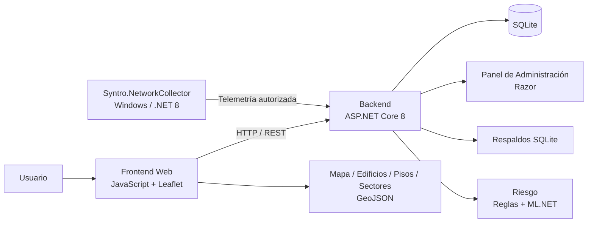

# SYNTRO — Capstone Grupo 2

SYNTRO es una solución desarrollada como proyecto Capstone de la carrera de **Ingeniería en Informática de Duoc UC, Sede San Joaquín**.

El proyecto busca apoyar la **localización, visualización, gestión y contraste de activos tecnológicos dentro de entornos hospitalarios**, mediante una aplicación web que relaciona la estructura física del recinto con el inventario oficial y con información obtenida desde procesos autorizados de observabilidad de red.

La solución está orientada principalmente a equipos de **Soporte TI, auditoría y administración técnica**, especialmente en organizaciones de gran extensión física donde localizar rápidamente un equipo, edificio o dependencia puede resultar complejo.

> **Alcance vigente del MVP:** computadores (PC) e impresoras.

---

## Problema que resuelve

En instalaciones hospitalarias de gran tamaño, los equipos de soporte pueden enfrentar dificultades para:

- identificar dónde se encuentra físicamente un equipo;
- localizar edificios, pisos y sectores dentro del recinto;
- relacionar el inventario oficial con los equipos observados en la red;
- identificar cambios o discrepancias entre información registrada y observada;
- mantener trazabilidad de modificaciones relevantes;
- disponer de una visualización centralizada del inventario, ubicación y observabilidad.

SYNTRO centraliza esta información y la representa mediante un **mapa interactivo, inventario, dashboard y vistas de observabilidad**.

La información detectada mediante escaneo o telemetría es **complementaria al inventario oficial**. Una coincidencia o discrepancia de red no crea, modifica ni elimina automáticamente un activo: cualquier cambio sobre la información oficial requiere una acción explícita de un usuario autorizado.

---

## Integrantes

| Integrante | Rol principal en el proyecto |
|---|---|
| **Constanza Gaete** | Dirección del proyecto, requisitos funcionales, experiencia de usuario, mockups y presentación del producto |
| **Antonia Pacheco** | Análisis, documentación, requisitos no funcionales, trazabilidad, calidad y apoyo en diseño funcional |
| **Paolo Vilches** | Desarrollo de software, arquitectura técnica, modelo de datos, integración y despliegue |

---

## Información académica

- **Asignatura:** Capstone
- **Código de asignatura:** PTY4614
- **Sección:** 006
- **Jornada:** Vespertina
- **Profesor guía:** Alex Zúñiga Montiel
- **Institución:** Duoc UC
- **Sede:** San Joaquín
- **Periodo académico:** 2026

---

## Alcance funcional vigente

El MVP considera, entre otras capacidades:

- gestión de inventario de **computadores e impresoras**;
- estructura física **Campus/Sitio → Edificio → Piso → Sector → Equipo**;
- mapa interactivo y localización de activos;
- búsqueda, consulta y actualización controlada del inventario;
- importación Excel/CSV, merge, reconciliación y reglas de alias;
- auditoría y trazabilidad;
- observabilidad de red mediante escaneos autorizados;
- snapshots históricos y exportación según permisos;
- evaluación y visualización de riesgo;
- gestión de usuarios y roles;
- escaneos manuales y programados;
- gestión de respaldos SQLite;
- gestión de red peatonal mediante nodos, aristas y tramos;
- dashboard de inventario, ubicación y observabilidad.

### Fuera del alcance actual

- datos clínicos o de pacientes;
- actualización automática del inventario desde telemetría;
- aplicación móvil nativa o modo offline;
- modelo 3D del recinto;
- gestión financiera o contractual de activos;
- restauración automática de la base activa;
- cálculo automático de rutas origen→destino.

La red peatonal sí permite gestionar su grafo —incluyendo operaciones como creación de tramos, snapping, merge y split—, pero **no implementa pathfinding backend origen→destino**.

---

## Roles funcionales

SYNTRO mantiene cuatro roles funcionales oficiales:

| Rol | Alcance general |
|---|---|
| **Administrador** | Administración completa de usuarios, estructura física, inventario, escaneos, respaldos y configuración |
| **Soporte técnico** | Mantención operativa de inventario y ubicación, además de consulta de mapa, dashboard y observabilidad |
| **Auditor** | Consulta de información, auditoría y observabilidad; puede ejecutar/controlar escaneos autorizados y exportar snapshots según permisos |
| **Visualizador** | Acceso de solo lectura a las vistas habilitadas |

> En la implementación puede existir el identificador técnico interno `editor`; funcionalmente corresponde al rol **Soporte técnico** y no constituye un quinto rol oficial.

---

## Tecnologías utilizadas

### Frontend

- JavaScript vanilla
- Leaflet
- Leaflet.draw
- Webpack
- HTML / CSS

### Backend

- .NET 8
- ASP.NET Core 8
- Entity Framework Core
- Razor Pages / panel de administración
- ML.NET para componentes de clasificación/riesgo, con apoyo de reglas

### Persistencia

- SQLite

### Infraestructura y ejecución

- Docker
- Docker Compose
- Nginx
- Arquitectura **on-premise**

### Observabilidad de red

- .NET 8
- Aplicación `Syntro.NetworkCollector`
- Ejecución en Windows
- WMI, `quser`, ping, DNS y sondas TCP según configuración autorizada

### Pruebas

- xUnit
- SQLite en memoria
- Jest

> La solución no depende obligatoriamente de servicios cloud para sus funciones principales. El despliegue previsto para el MVP es **local/on-premise**.

---

## Arquitectura de la solución

SYNTRO se organiza como un monorepo modular con tres componentes principales:

1. **Frontend web:** mapa interactivo, edificios, pisos, sectores, inventario, red peatonal y vistas de consulta utilizando Leaflet.
2. **Backend / API:** seguridad, reglas de negocio, usuarios, inventario, ubicaciones, auditoría, respaldos, escaneos programados y persistencia.
3. **Recolector de red:** componente Windows para tareas de observabilidad y recolección de información técnica autorizada.



### Flujo simplificado

```text
Inventario oficial + estructura física
               │
               ▼
        ASP.NET Core API
          │          │
          │          ├── SQLite
          │          ├── Auditoría
          │          ├── Respaldos
          │          └── Riesgo / telemetría
          │
          ▼
Frontend + Leaflet
          │
          ▼
Mapa / Inventario / Dashboard

Red autorizada
      │
      ▼
Syntro.NetworkCollector
      │
      └────────► API / snapshots de observabilidad
```

---

## Metodología de trabajo

El proyecto utiliza una metodología **Cascada (SDLC) con ciclos cortos internos de revisión**.

El trabajo se organiza en las siguientes etapas:

1. **Levantamiento y análisis de requisitos**
2. **Diseño funcional y técnico**
3. **Implementación**
4. **Pruebas y validación**
5. **Despliegue, documentación y cierre**

Los artefactos formales de cada etapa se utilizan como línea base para las siguientes actividades. Los cambios posteriores al alcance o requisitos aprobados deben gestionarse mediante **control de cambios** y mantenerse sincronizados con la ERS y la Matriz de Requisitos.

---

## Ejecución local

La forma recomendada de ejecutar SYNTRO localmente es mediante **Docker y Docker Compose**.

### Requisitos previos

- Git
- Docker
- Docker Compose v2
- Aproximadamente 5 GB libres para la construcción inicial
- Puertos requeridos disponibles: **8081, 5001 y 5002**

En Windows se utiliza Docker Desktop con backend WSL2. En Linux o macOS puede utilizarse Docker Engine o Docker Desktop según el ambiente.

### 1. Clonar el repositorio

```bash
git clone https://github.com/zomni/Syntro.git
cd Syntro
```

### 2. Configurar variables de entorno

Crear el archivo `.env` tomando como referencia:

```text
backend/.env.example
```

Es necesario definir, entre otras variables, las credenciales del administrador inicial:

```env
ADMIN_EMAIL=correo@ejemplo.cl
ADMIN_PASSWORD=contraseña_segura
```

Las credenciales reales no deben versionarse ni publicarse.

### 3. Construir e iniciar los servicios

```bash
docker compose up -d --build
```

### 4. Verificar el estado

```bash
docker compose ps
```

Si el backend presenta errores:

```bash
docker compose logs -f api
```

### 5. Acceder a la aplicación

Una vez iniciados los servicios:

- **Mapa / Frontend:** `http://localhost:8081`
- **API:** `http://localhost:5001`
- **Panel de administración:** `http://localhost:5001/dashboard`

### Ejecución para desarrollo

#### Backend

```bash
dotnet run --project backend/Syntro.API
```

#### Pruebas del backend

```bash
dotnet test backend/Syntro.sln
```

#### Frontend

```bash
cd frontend
npm ci
npm run build
```

#### Pruebas del frontend

```bash
npm test
```

---

## Estructura principal del proyecto

```text
Syntro/
├── backend/
│   └── Syntro.API/              # API, servicios y panel de administración
├── frontend/                    # Mapa e interfaz web
├── tools/
│   └── Syntro.NetworkCollector/ # Recolector de telemetría de red
├── spec/                        # Especificaciones técnicas
├── docs/                        # Documentación de arquitectura y desarrollo
└── docker-compose.yml           # Stack de ejecución local
```

El repositorio oficial `zomni/Syntro` constituye la **fuente de verdad técnica** del código y de la documentación técnica versionada.

---

## Inventario y observabilidad de red

SYNTRO mantiene una separación explícita entre:

- **inventario oficial:** información validada y administrada por usuarios autorizados;
- **telemetría / observabilidad:** información detectada durante escaneos autorizados.

El matching hacia inventario prioriza:

1. `SerialNumber` exacto;
2. `MacAddress` válida.

IP, hostname y username pueden aportar contexto, pero no sustituyen esas claves principales de coincidencia.

Los escaneos se realizan únicamente sobre rangos previamente configurados y autorizados. La línea base contempla escaneos manuales y programados, control de ejecuciones, snapshots históricos y trazabilidad.

> Existe una brecha técnica conocida respecto de la exclusión mutua de ejecuciones simultáneas sobre el mismo alcance. Su cierre forma parte de la validación técnica y de QA vigente.

---

## Respaldos

El MVP permite al Administrador:

- crear respaldos completos SQLite;
- listar respaldos disponibles;
- descargarlos;
- verificar su integridad.

La línea base contempla controles como hash SHA-256 e `integrity_check` de SQLite según la implementación vigente.

> La **restauración automática sobre la base activa no forma parte del alcance actual**.

---

## Contenido documental del Capstone

La documentación y evidencias académicas del proyecto se organizan por las distintas fases de trabajo del Capstone:

- **Fase 1**
- **Fase 2**
- **Fase 3**

Los artefactos formales incluyen planificación, requisitos, diseño, arquitectura, modelo de datos, pruebas, documentación técnica, privacidad, implantación, manuales y evidencias asociadas a la presentación y evaluación del proyecto.

La documentación formal complementa al repositorio, pero no reemplaza el historial de código ni la fuente de verdad técnica versionada en Git.

---

## Estado del proyecto

SYNTRO se encuentra en etapa de **cierre del MVP académico**, con actividades de pruebas finales, documentación, validación e implantación.

La línea base vigente contempla **computadores e impresoras**, cuatro roles funcionales oficiales y el alcance definido en la ERS y la Matriz de Requisitos.

Los cambios posteriores a la línea base aprobada deben gestionarse mediante control de cambios; no se consideran parte del alcance por el solo hecho de existir como código experimental o propuesta futura.
